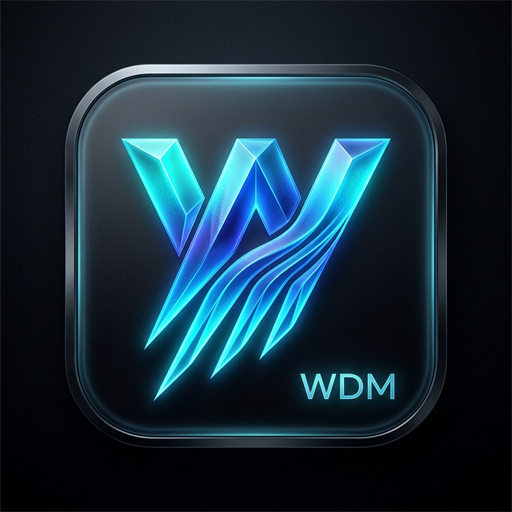

<p align="center">
  
</p>

<h1 align="center">WDM — Windows Download Manager</h1>
<p align="center"><b>Next-Generation Open-Source Parallel Download Manager for Windows & Web</b></p>
<p align="center">
  Developed by <b>Joash</b> &bull; <a href="mailto:alfredjoejr@duck.com">alfredjoejr@duck.com</a> &bull; <a href="https://github.com/alfredjoejr/WDM">GitHub</a>
</p>

---

## 🚀 Key Advantages Over IDM

1. **Zero-Stitch Instant Disk Completion**:
   - IDM downloads chunks as separate temp files (`.part0`, `.part1`, etc.) and slowly stitches them at 100%, causing disk bottlenecks.
   - WDM pre-allocates the target file and uses .NET `RandomAccess` with Windows overlapped I/O to allow multiple worker threads to stream directly into their assigned byte offsets in parallel. **Zero merge time when the download hits 100%!**
2. **Modern Protocol Support**:
   - Full support for HTTP/3 (QUIC multiplexing), HTTP/2, and HTTP/1.1 with socket pooling.
3. **Resumable State Checkpoints**:
   - Saves chunk download states (`.wdm-state`) to survive network dropouts or machine reboots.
4. **Built-in Security Verification**:
   - High-throughput streaming cryptographic hash calculation (SHA-256, SHA-512, SHA-1, MD5).
5. **Media Stream Bridge**:
   - Architecture in place to sniff and extract adaptive streaming media (YouTube, HLS `.m3u8`, DASH `.mpd`).

---

## 📁 Project Architecture

- **`src/WDM.Core`**: The high-performance core engine class library.
  - `Network/`: `HttpProbe`, `HttpClientFactory` (HTTP/3 & socket pooling).
  - `Storage/`: `DiskManager` (RandomAccess zero-stitch I/O), `CheckpointStore` (pause/resume).
  - `Engine/`: `DownloadEngine`, `BandwidthThrottler`.
  - `Security/`: `ChecksumVerifier` (SHA-256 / MD5).
  - `Media/`: `MediaExtractor` (YouTube / HLS / DASH sniffer bridge).
- **`src/WDM.Cli`**: Feature-complete terminal client powered by Spectre.Console.
- **`tests/WDM.Core.Tests`**: Automated test suite for multi-threading, chunking, and hashing.

---

## 🛠️ Usage & Commands

Run using the .NET CLI:

### 1. Download with Parallel Chunking
```bash
dotnet run --project src/WDM.Cli/WDM.Cli.csproj -- download https://proof.ovh.net/files/100Mb.dat -c 16
```
Options:
- `-c <num>`: Number of parallel connections (default: `16`, up to `64`).
- `-o <dir>`: Target download directory.
- `-f <name>`: Custom file name.
- `-l <limit>`: Speed cap (e.g., `-l 5MB` or `-l 500KB`).

### 2. Inspect Server Capabilities & Range Support (Probe)
```bash
dotnet run --project src/WDM.Cli/WDM.Cli.csproj -- probe https://proof.ovh.net/files/1Mb.dat
```

### 3. Compute & Verify Checksums
```bash
dotnet run --project src/WDM.Cli/WDM.Cli.csproj -- hash path/to/file.zip sha256
```

### 4. Media Stream Extraction (YouTube, HLS, DASH)
```bash
dotnet run --project src/WDM.Cli/WDM.Cli.csproj -- media https://www.youtube.com/watch?v=...
```

### 5. Multi-Connection Benchmark
Compare 1 vs 4 vs 8 vs 16 connections side-by-side:
```bash
dotnet run --project src/WDM.Cli/WDM.Cli.csproj -- benchmark https://proof.ovh.net/files/10Mb.dat
```

---

## 🖥️ Launching the Modern Desktop UI

To start the hardware-accelerated desktop dashboard:
```bash
dotnet run --project src/WDM.UI/WDM.UI.csproj
```
Or directly double-click the published standalone executable:
```
bin\WDM.UI\WDM.UI.exe
```

---

## 🌐 Loading the Browser Extension (Chrome / Edge / Brave)

1. **Register the Native Host**:
   Double-click `extension/install-host.bat` (or run `./bin/NativeHost/WDM.NativeHost.exe --install`). This registers the Native Messaging Host in your Windows Registry under `HKCU`.
2. **Open Extensions Page**:
   - In Chrome/Brave: navigate to `chrome://extensions`
   - In Edge: navigate to `edge://extensions`
3. **Enable Developer Mode**:
   Toggle the **"Developer mode"** switch (top-right corner).
4. **Load Unpacked**:
   Click **"Load unpacked"** and select the [`extension/`](file:///c:/Users/joash/OneDrive/Documents/Github/WDM/extension) folder.
5. **Ready!**
   - Click the WDM icon in your browser toolbar to view the popup dashboard.
   - Any file downloaded from the web will be caught and accelerated by WDM.
   - Any video page (YouTube, Vimeo, etc.) will display the floating "⚡ Download Video" pill.

---

## 📋 Roadmap Status

- [x] **Step 1: Core Engine & Initial Components (.NET 10)**
  - [x] Dynamic HTTP Range & Header Probe
  - [x] High-performance parallel chunk downloader
  - [x] Zero-stitch direct disk write engine (`RandomAccess`)
  - [x] Pause / resume checkpoint storage
  - [x] Bandwidth throttler (token bucket)
  - [x] Cryptographic hash verifier (SHA-256, MD5)
  - [x] Media extraction bridge interface
  - [x] Rich CLI runner with Spectre.Console
  - [x] Automated test suite (6/6 passing)
- [x] **Step 2: Browser Extension & Native Messaging Host**
  - [x] Manifest V3 WebExtension (`extension/`)
  - [x] Dedicated Native Messaging Host (`src/WDM.NativeHost`)
  - [x] Windows Registry auto-installer for Chrome, Edge, Brave, and Firefox
  - [x] Download interception (`chrome.downloads.onDeterminingFilename`)
  - [x] Floating video sniffer badge on HTML5 players (`content.js` + `content.css`)
  - [x] Glassmorphic dark-mode popup dashboard (`popup/`)
  - [x] Right-click context menus ("Download with WDM", "Download Media with WDM")
- [x] **Step 3: Desktop UI**
  - [x] Modern Windows 11 Fluent / Mica interface with hardware-accelerated WebView2
  - [x] Live oscilloscope bandwidth spline chart (HTML5 Canvas)
  - [x] Interactive **Parallel Worker Threads Drawer** (real-time chunk offset visualization)
  - [x] Integrated Streaming Media Grabber (YouTube, HLS, DASH)
  - [x] Live ISP multi-connection benchmark suite
  - [x] Native shell actions (Open File, Show in Windows Explorer, SHA-256 copy)
  - [x] Auto-clipboard link sniffer
  - [x] Published standalone application (`bin/WDM.UI/WDM.UI.exe`)
